# Face Recognition: My 4 Friends, a Classifier, and Face Verification

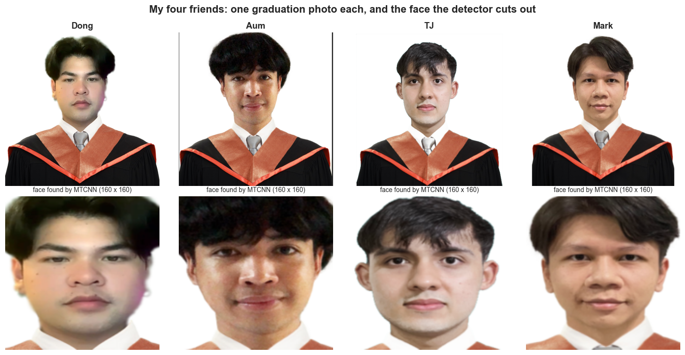

Face recognition | Face verification | Open-set recognition | Data augmentation | Eigenfaces (PCA) | SVM | CNN | Face embeddings | FaceNet | MTCNN | Transfer learning | Cosine similarity | ROC | False accept rate | Equal error rate | Occlusion map | PyTorch | Gradio

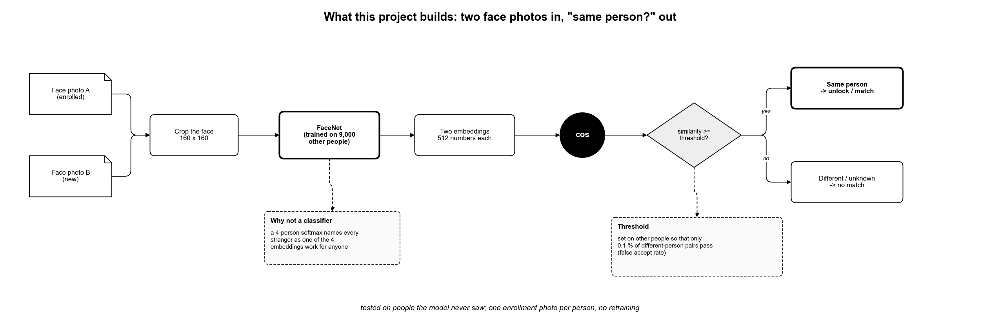

## Objective

- **Problem** → a CNN that recognises my four friends (Dong, Aum, TJ, Mark) from one graduation photo each is easy to build and scores 100 %, but it can only pick from its list: shown anyone else, it still answers with one of their names
- **Why this repo** → build that classifier, test it on **new photos of my friends** it never saw, show where it breaks, then do what real systems do: enroll each friend from their one photo as an embedding, and answer "same person", "which friend" or "unknown" by distance
- **Real-world use** → phone unlock, door access, photo tagging: one enrollment photo per person, no retraining, and "no match" as a normal answer

## Highlights

**Question:** can a model tell my 4 friends apart?

**Answer:** on augmented copies of their graduation photos, perfectly (100 % for Eigenfaces + SVM and a small CNN). On **88 new photos of them** (another day and place, head turned up to full profile), the CNN is right on only **53 %** and Eigenfaces on 33 %, where always answering "Mark" would already get 45 %. The models learned the 4 photos, not the 4 faces.

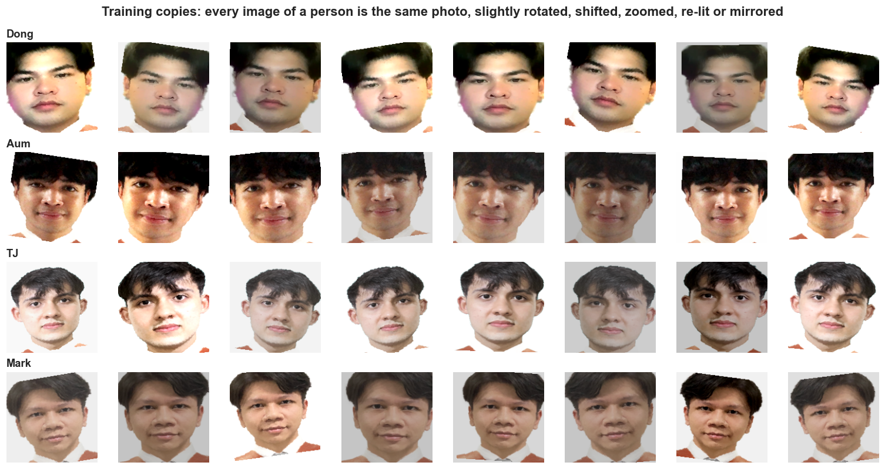

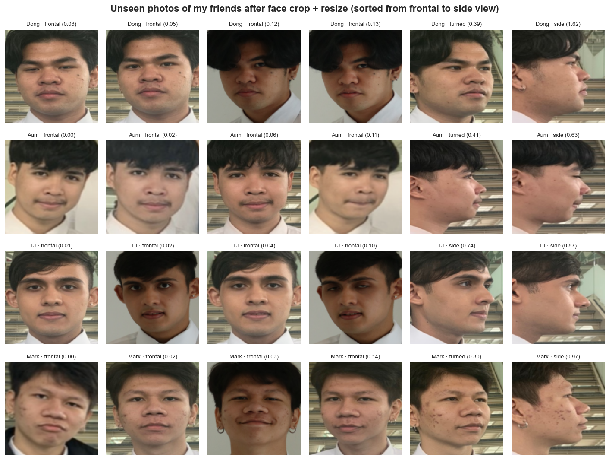

**Question:** what does that classifier say about strangers?

**Answer:** it names every one of 1,000 strangers (LFW public figures) as one of my friends, and mostly as the same one: **88 % become "Mark"**, 84 % with at least 90 % confidence.

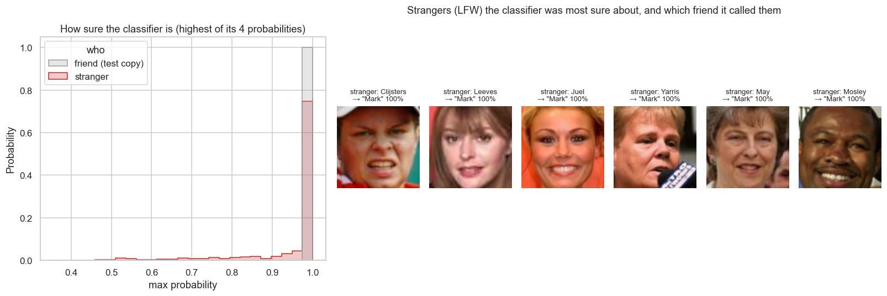

**Question:** can a face embedding recognise my friends on new photos, from one enrollment photo each, and turn strangers away?

**Answer:** yes. FaceNet, enrolled from one graduation photo per friend with a threshold chosen on other people, names **95.5 % of the 88 new photos** correctly and turns away **99.7 %** of strangers.

| | Unseen photos named correctly | Strangers turned away | To add a friend |
|---|---|---|---|
| Small CNN + probability cut-off | 0 % | 57.0 % | collect photos, retrain |
| FaceNet + 1 photo per friend | 95.5 % | 99.7 % | add one photo |

- **By head turn** → frontal 98.2 %, turned 94.7 %, side view 85.7 % named correctly
- **The only mistakes** → 4 of Aum's 10 photos named "Dong"; Dong, Mark and TJ are recognised on every photo
- **Why** → Dong and Aum's enrollment photos are already at similarity **0.57**, above the 0.53 "same person" threshold: the same studio, gown, light and pose pull two different people together
- **The CNN's cut-off** → to accept 95 % of the copies it needs probability ≥ 0.9997; no new photo of my friends reaches that, but 43 % of strangers do

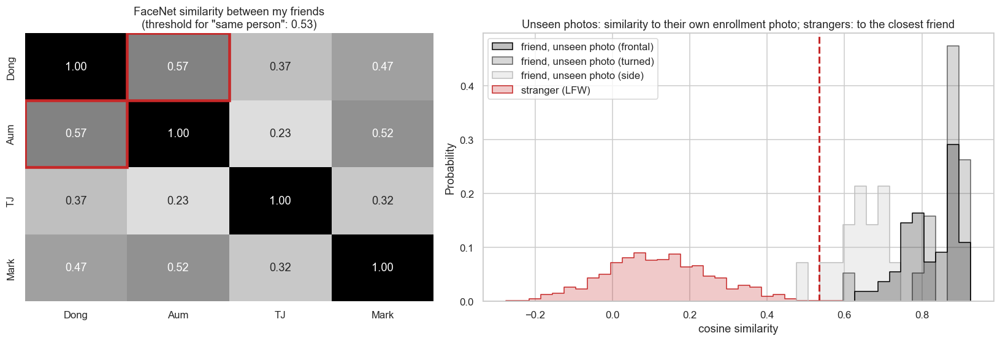

**Question:** how well does it tell "same person" from "different people" for people it never saw?

**Answer:** my friends have one photo each, so this is measured on LFW people, split by person: FaceNet almost perfectly, generic image features far worse.

| Embedding (test pairs of unseen LFW people) | AUC | Equal error rate | Same-person pairs accepted at the threshold |
|---|---|---|---|
| FaceNet (trained on faces) | 0.999 | 1.1 % | 96.0 % at 0.07 % false accepts |
| ResNet-18 (trained on ImageNet objects) | 0.776 | 29.3 % | 6.6 % |
| Eigenfaces (PCA) | 0.730 | 33.0 % | 10.0 % |

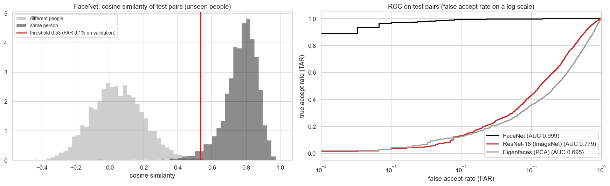

## [1/8] Data

- **My friends** → `friends/`: one graduation photo each (Dong, Aum, TJ, Mark), 512 × 512, all from the same studio session; MTCNN finds every face (confidence ≥ 0.9999) and crops it to 160 × 160
- **My friends, unseen** → `rand_images/`: 88 new photos (Dong 24, Aum 10, TJ 14, Mark 40) from another day and place, `.jpg` / `.JPG` / `.png`, up to 6000 × 4000; each face is found, cropped and resized to 160 × 160 by MTCNN after applying the camera's rotation tag (without it, 15 camera photos had no face found); 55 frontal, 19 turned, 14 side views
- **Strangers** → [Labeled Faces in the Wild](https://www.kaggle.com/datasets/jessicali9530/lfw-dataset) · 13,233 news photos of 5,749 public figures · not stored in this repository (mounted on Kaggle, or downloaded by scikit-learn)
- **LFW long tail** → 4,069 people have a single photo, 12 have 50 or more (George W Bush: 530); only 1 near-duplicate pair

## [2/8] Run on Kaggle

- **Import** → Create → Import Notebook → upload `face_verification.ipynb`
- **Input** → dataset `jessicali9530/lfw-dataset` (found anywhere under `/kaggle/input`; without it, LFW is downloaded with scikit-learn)
- **My friends' photos** → downloaded from this repository (`friends/`, and `rand_images/` via its `manifest.json`) when the notebook starts
- **Accelerator** → GPU T4 (about 5 minutes); a CPU works but is slower
- **Internet** → On: `pip install --no-deps facenet-pytorch`, FaceNet and ResNet-18 weights, the friends' photos
- **Settings** → top cell; `SAVE_FIGURES = False`, `LAUNCH_APP = False` → nothing is written except `settings.json` (the threshold for the app), no app is started
- **Pictures** → the notebook links its explanation pictures from this repository instead of embedding them, so it stays small

## [3/8] The classic classifier

- **Training data** → 150 / 25 / 25 augmented copies per friend for train / validation / test (random rotation ±10°, shift ±6 %, zoom ±10 %, brightness and contrast ±25 %, mirror), different random draws per split
- **Eigenfaces + SVM** → 64 × 64 grey faces → PCA (100 components, whitened) → RBF SVM → 100 % on copies, 33 % on unseen photos
- **Small CNN** → 4 convolution blocks, flattened 6 × 6 map, dropout, softmax; normalised input → 100 % on copies, 53 % on unseen photos

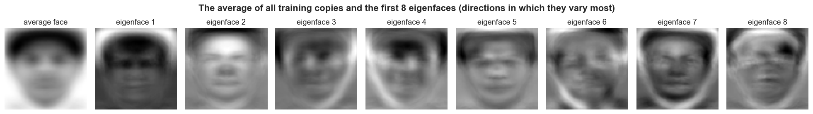

## [4/8] Why a classifier is not recognition

- **Closed set** → softmax probabilities sum to 1, so every face lands on one of the 4 friends; nothing can be "unknown"
- **Strangers** → all 1,000 named as a friend: 88.4 % "Mark", 9.7 % "Dong", 1.2 % "TJ", 0.7 % "Aum"
- **New people** → each one needs photos and retraining

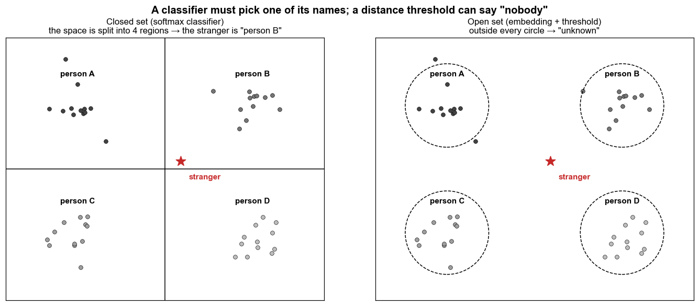

## [5/8] Face embeddings

- **FaceNet** (Inception-ResNet, VGGFace2 weights: 3.3 million photos of 9,000 people) → 512 numbers per 160 × 160 face, compared by cosine similarity
- **Baselines** → ResNet-18 ImageNet features (512 numbers) and Eigenfaces fitted on validation people only
- **What the map shows** → FaceNet puts each person's photos in one tight group; the ImageNet features mix people up

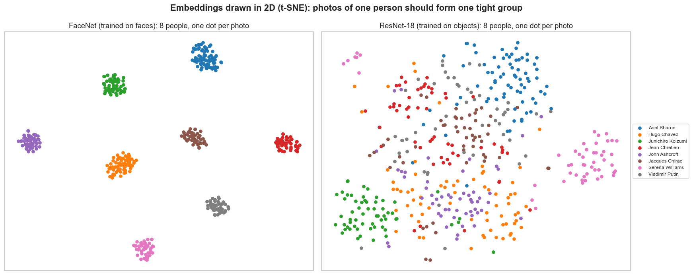

## [6/8] Honest verification

- **Split by person** → every LFW person with ≥ 2 photos, split 50 / 50 into validation people and test people
- **Pairs** → 3,000 same-person pairs (each person equally likely, so Bush's 530 photos don't dominate) + 3,000 different-person pairs per half, near-duplicates skipped
- **Threshold** → chosen on validation so only 0.1 % of different-person pairs pass (cosine 0.53), then applied to test unchanged → test false accepts 0.07 %, same-person pairs accepted 96.0 %
- **Two errors** → a false accept lets a stranger in, a false reject makes the owner try again; the application picks the balance (`TARGET_FAR`)

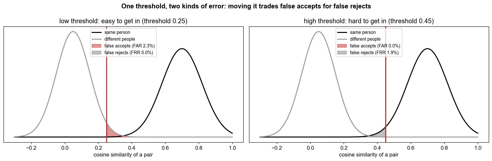

## [7/8] Where does it look?

- **Occlusion test** → slide a grey 20 × 20 square over a friend's most frontal unseen photo and measure the drop in similarity to their enrollment photo
- **Result** → the eyes, the nose and the area between the eyebrows matter most; the background, the hair and the gown hardly matter

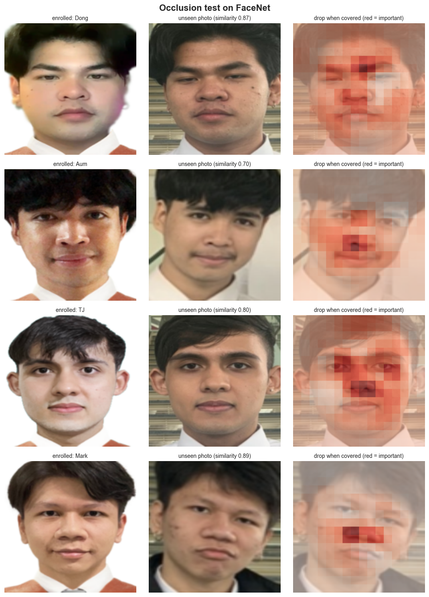

## [8/8] App, limitations and next steps

- **App** → `pip install -r requirements.txt` → `pip install --no-deps facenet-pytorch` → `python app.py`
  - **Who is this?** → one photo in → Dong, Aum, TJ, Mark or "unknown", with the similarity to each friend
  - **Same person?** → two photos in → "same person" or "different / unknown"
  - faces found with MTCNN; threshold from `models/settings.json` (written by the notebook), else 0.53
- **Few unseen photos** → 88 photos of 4 people (only 10 of Aum) show the pattern, not precise accuracies; the "same or different" numbers come from 840 unseen LFW people
- **Same session** → all four enrollment photos share the studio, gown and light, which pushes Dong and Aum above the threshold and causes every mistake on the unseen photos; enroll from 2-3 photos taken in different settings
- **Who is in LFW** → news photos of public figures, reported to be mostly men with lighter skin; error rates for other groups can be higher, and LFW has no labels to measure that
- **Consent** → faces are biometric data: only use photos of people who agreed to it
- **Next steps** → enroll each friend from 2-3 photos (average the embeddings), set the threshold on friends' photos too, fine-tune an embedding with ArcFace, and test on harder benchmarks (cross-pose, cross-age)

| Path | Content |
|---|---|
| `face_verification.ipynb` | full notebook (Kaggle-ready) |
| `friends/` | the four enrollment photos (Dong, Aum, TJ, Mark) |
| `rand_images/` | new, unseen photos of the four friends (the real test), with `manifest.json` |
| `app.py`, `requirements.txt` | Gradio app: "Who is this?" and "Same person?" |
| `models/settings.json` | threshold chosen in the notebook |
| `assets/png/` · `assets/drawio/` | figures (PNG) · editable draw.io diagram |
| `arch/` | the original notebooks, scripts, photos (`Images/`) and app screenshot |
